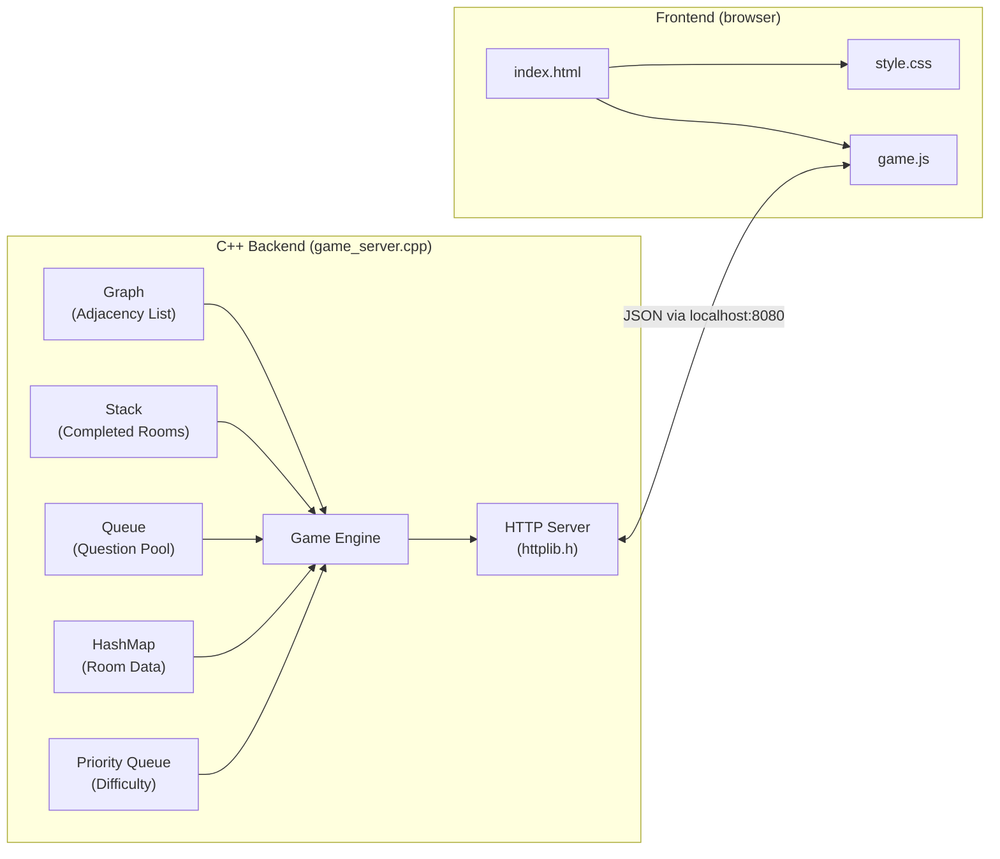
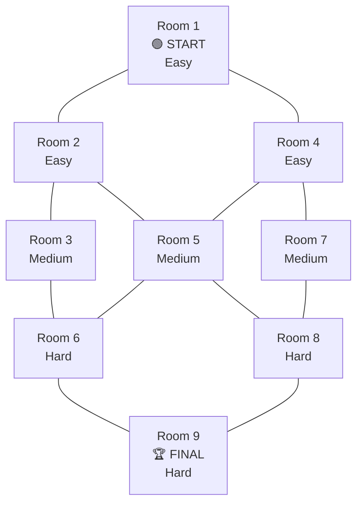

# EscapeX — Implementation Plan

## Goal Description

Build **EscapeX**, an escape-room puzzle game that demonstrates five core data structures — **Graph, Stack, Queue, HashMap, and Priority Queue** — through an interactive web-based game. The C++ backend owns all game logic and data structure operations. A simple HTML/CSS/JS frontend provides the visual interface. The project is an **Advanced Data Structures & Algorithms** academic project — code must be straightforward, well-commented, and easy to understand.

## Game Flow (from user-provided flowchart)


---

## Resolved Design Decisions

> [!NOTE]
> All open questions have been resolved per user feedback:
> 1. **Rooms:** 9 rooms in a 3×3 graph ✅
> 2. **Timer:** Dynamic — player chooses between **1 to 5 minutes** at game start (dropdown on the start screen)
> 3. **Questions:** Mix of **interesting logic puzzles, math pattern questions, general knowledge, and basic DSA** (e.g., time complexities of sorting, stack/queue behavior). NO trivially easy questions like "2+2"
> 4. **Retries:** **Unlimited retries** with a **5-second time penalty** per wrong answer
> 5. **Backend:** C++ with `httplib.h` (single-header HTTP library) ✅
> 6. **Simplicity:** No templates, no design patterns, no inheritance, no smart pointers. Only `struct`, free functions, and basic STL containers ✅

---

## Architecture Overview



### How it works
1. Compile and run `game_server.cpp` → starts a local HTTP server on `localhost:8080`
2. Open `index.html` in any browser → it talks to the C++ server via `fetch()`
3. All data structure operations happen **in C++** — the frontend just displays the state

---

## Data Structure Mapping

| Data Structure | C++ Implementation | Purpose | Why This DS? |
|---|---|---|---|
| **Graph** | `vector<vector<int>> adjList` | Room connections | Rooms are nodes, doors are edges. Adjacency list is the simplest graph representation — O(1) to check neighbors |
| **Stack** | `stack<int> completedRooms` | Completion history | LIFO lets us show "most recently completed first" and reverse-order history |
| **Queue** | `queue<Question> questionPool` | Question management | FIFO ensures each question is used once, in shuffled order — fair distribution |
| **HashMap** | `unordered_map<int, Room> rooms` | Room data storage | O(1) lookup by room ID — fast access to any room's puzzle, status, score |
| **Priority Queue** | `priority_queue<Question> difficultyQueue` | Dynamic difficulty | Automatically surfaces harder questions as player progresses — max-heap by difficulty |

---

## Proposed Changes

### Project Directory Structure

```
ADS (Project)/
├── backend/
│   ├── game_server.cpp          # [NEW] Main C++ file — ALL game logic + server
│   ├── httplib.h                # [NEW] Single-header HTTP library (downloaded)
│   └── questions.h              # [NEW] Hardcoded question bank
├── frontend/
│   ├── index.html               # [NEW] Game UI
│   ├── style.css                # [NEW] Styling
│   └── game.js                  # [NEW] Frontend logic (fetch calls)
├── EscapeX_Project.md           # [NEW] Complete project documentation
├── phases.md                    # [NEW] Development phases
└── README.md                    # [NEW] Quick start guide
```

**Total files to write: 8** (including docs). That's the entire project.

---

### Component 1: Backend — Data Structures & Game Engine

#### [NEW] `backend/game_server.cpp`

This single file contains ALL C++ code. Here's the structure:

```cpp
// ============================================
// EscapeX — Game Server
// All data structures are implemented here
// ============================================

#include "httplib.h"
#include "questions.h"
#include <vector>
#include <stack>
#include <queue>
#include <unordered_map>
#include <string>
#include <algorithm>
#include <ctime>
#include <sstream>

// ---- STRUCTS (simple, no classes) ----

struct Question {
    int id;
    string text;
    string hint;
    vector<string> options;   // 4 options
    int correctOption;        // 0-3
    int difficulty;           // 1=easy, 2=medium, 3=hard
    int points;               // 10, 20, 30

    // For priority queue — higher difficulty = higher priority
    bool operator<(const Question& other) const {
        return difficulty < other.difficulty;
    }
};

struct Room {
    int id;
    string name;
    int difficulty;           // 1, 2, 3
    bool isLocked;
    bool isCompleted;
    int questionId;           // assigned question
    int score;                // points earned
};

// ---- GLOBAL GAME STATE ----

// GRAPH — adjacency list for room connections
vector<vector<int>> adjList;

// STACK — completed rooms (push on completion, pop for history)
stack<int> completedStack;

// QUEUE — shuffled questions ready to be assigned
queue<Question> questionQueue;

// HASHMAP — room data by room ID
unordered_map<int, Room> roomMap;

// PRIORITY QUEUE — questions sorted by difficulty
priority_queue<Question> difficultyPQ;

// Timer — player chooses duration at start (60 to 300 seconds)
int totalTime = 300;     // default 5 minutes, set by player choice
int timePenalty = 0;     // accumulated penalty from wrong answers
int totalScore = 0;
bool gameActive = false;
time_t gameStartTime;

// ---- FUNCTIONS (all simple, no OOP) ----

void initializeGraph() { /* build adjacency list */ }
void initializeRooms() { /* populate roomMap */ }
void shuffleAndLoadQuestions() { /* shuffle → queue */ }
void assignQuestionsToRooms() { /* dequeue → room */ }
void startGame() { /* reset everything, start timer */ }
string checkAnswer(int roomId, int answer) { /* verify, update */ }
string getGameState() { /* return JSON of current state */ }
string getCompletionHistory() { /* pop stack, build history */ }
vector<int> getUnlockedRooms(int roomId) { /* check adjList */ }

// ---- HTTP SERVER ----

int main() {
    httplib::Server svr;

    // Serve frontend files
    svr.set_mount_point("/", "../frontend");

    // API endpoints
    svr.Get("/api/start",       /* start game */);
    svr.Get("/api/state",       /* get game state */);
    svr.Post("/api/answer",     /* submit answer */);
    svr.Get("/api/history",     /* get completion history */);
    svr.Get("/api/room/:id",    /* get room details */);

    svr.listen("localhost", 8080);
    return 0;
}
```

**Key simplicity rules applied:**
- No classes, only `struct` and free functions
- No templates, no inheritance, no polymorphism
- No smart pointers — no pointers at all (everything by value or reference)
- JSON is built manually with string concatenation (no JSON library needed)
- Every function does ONE thing and is ≤30 lines

---

#### [NEW] `backend/questions.h`

A simple header with hardcoded questions:

```cpp
#ifndef QUESTIONS_H
#define QUESTIONS_H

#include <vector>
#include <string>
using namespace std;

struct QuestionData {
    string text;
    string hint;
    vector<string> options;
    int correctOption;
    int difficulty;
    int points;
};

// ~30 questions across 3 difficulty levels (logic, math patterns, GK, basic DSA)
vector<QuestionData> ALL_QUESTIONS = {
    // Easy (difficulty=1, points=10)
    {"What is the time complexity of accessing an element in an array by index?",
     "Think about direct memory access", {"O(n)","O(1)","O(log n)","O(n²)"}, 1, 1, 10},
    // ... more questions (interesting logic, math patterns, DSA basics)
    
    // Medium (difficulty=2, points=20)
    // Hard (difficulty=3, points=30)
};

#endif
```

---

#### [NEW] `backend/httplib.h`

Downloaded from [cpp-httplib](https://github.com/yhirose/cpp-httplib). This is a **single header file** — no installation, no build system, no dependencies. Just `#include "httplib.h"` and it works.

---

### Component 2: Frontend — HTML/CSS/JS

#### [NEW] `frontend/index.html`

Simple semantic HTML:

```html
<!DOCTYPE html>
<html>
<head>
    <title>EscapeX</title>
    <link rel="stylesheet" href="style.css">
</head>
<body>
    <!-- Start Screen -->
    <div id="start-screen">
        <h1>🔓 EscapeX</h1>
        <p>Escape the rooms by solving puzzles!</p>
        <label>Choose Timer Duration:</label>
        <select id="timer-select">
            <option value="60">1 Minute</option>
            <option value="120">2 Minutes</option>
            <option value="180">3 Minutes</option>
            <option value="240">4 Minutes</option>
            <option value="300" selected>5 Minutes</option>
        </select>
        <button onclick="startGame()">Start Game</button>
    </div>

    <!-- Game Screen -->
    <div id="game-screen" hidden>
        <div id="header">
            <span id="timer">⏱ 5:00</span>
            <span id="score">🏆 0</span>
        </div>
        <div id="room-map"><!-- visual room grid --></div>
        <div id="puzzle-area"><!-- current puzzle --></div>
    </div>

    <!-- Result Screen -->
    <div id="result-screen" hidden>
        <h2>Game Over!</h2>
        <div id="final-score"></div>
        <div id="history"></div>
        <button onclick="location.reload()">Play Again</button>
    </div>

    <script src="game.js"></script>
</body>
</html>
```

#### [NEW] `frontend/style.css`

Clean, minimal CSS — no frameworks, no preprocessors:

```css
/* Simple grid layout for rooms, card-style puzzle display */
/* Color-coded rooms: locked=gray, unlocked=blue, completed=green */
/* Responsive but desktop-first (no complex media queries) */
```

#### [NEW] `frontend/game.js`

All frontend logic in one file — just `fetch()` calls to the C++ server:

```javascript
// Fetch game state every second (for timer updates)
// Send answer submissions via POST
// Update DOM based on server responses
// No frameworks, no build tools, just vanilla JS
```

---

## Room Graph Layout



**Adjacency List Representation:**
```
Room 1 → [2, 4]
Room 2 → [1, 3, 5]
Room 3 → [2, 6]
Room 4 → [1, 5, 7]
Room 5 → [2, 4, 6, 8]
Room 6 → [3, 5, 9]
Room 7 → [4, 8]
Room 8 → [5, 7, 9]
Room 9 → [6, 8]
```

---

## Game Mechanics

| Mechanic | Detail |
|---|---|
| **Timer** | Player chooses 1-5 minutes (60-300 seconds) at game start. Counts down. Game ends at 0. |
| **Correct Answer** | +10/20/30 points (easy/medium/hard). Room marked completed. Adjacent rooms unlocked. Room ID pushed to stack. |
| **Wrong Answer** | **-5 second time penalty**. Unlimited retries on the same room. |
| **Hints** | Each question has a hint. Using a hint costs -5 points from that room's reward. |
| **Dynamic Difficulty** | Priority queue feeds harder questions to later rooms. Early rooms = easy, middle = medium, end = hard. |
| **Win Condition** | Complete Room 9 (final room) before time runs out → bonus +50 points. |
| **Game Over** | Timer hits 0. Score calculated from stack. History displayed in reverse (LIFO). |
| **Questions** | Interesting logic puzzles, math patterns, general knowledge, and basic DSA (time complexities, etc.). No trivially easy questions. |

---

## API Endpoints

| Method | Endpoint | Request | Response |
|---|---|---|---|
| GET | `/api/start?time=300` | `time` query param (60-300) | Start new game with chosen timer, return initial state |
| GET | `/api/state` | — | Current game state (time, score, rooms) |
| GET | `/api/room/:id` | — | Room details + question |
| POST | `/api/answer` | `{roomId, answer}` | Correct/wrong, updated state |
| GET | `/api/history` | — | Completion history from stack |
| GET | `/api/hint/:roomId` | — | Hint for current room's question |

---

## Verification Plan

### Automated Tests

```bash
# 1. Compile the C++ backend
cd backend
g++ -std=c++17 -o game_server game_server.cpp -lpthread

# 2. Run the server
./game_server

# 3. Test API endpoints with curl
curl http://localhost:8080/api/start
curl http://localhost:8080/api/state
curl -X POST http://localhost:8080/api/answer -d '{"roomId":1,"answer":0}'
curl http://localhost:8080/api/history
```

### Manual Verification

1. **Start game** → Player selects timer (1-5 min), timer starts counting down, Room 1 is unlocked, all others locked
2. **Enter Room 1** → Question appears with 4 options and a hint button
3. **Answer correctly** → Score increases, adjacent rooms (2, 4) unlock, room turns green
4. **Answer incorrectly** → Timer drops by 5 seconds, can retry (unlimited)
5. **Progress through rooms** → Questions get harder (priority queue) — logic, math, DSA topics
6. **Timer hits 0** → Game over screen shows score + completion history in reverse order
7. **Play Again** → Full reset, questions re-shuffled

---

## Strict Coding Rulebook (Summary)

These rules are enforced throughout the entire project:

1. ❌ No classes — only `struct` and free functions
2. ❌ No templates (except STL containers)
3. ❌ No inheritance, no polymorphism, no virtual functions
4. ❌ No smart pointers, no raw pointers, no `new`/`delete`
5. ❌ No external libraries except `httplib.h` (single header)
6. ❌ No CSS frameworks (no Bootstrap, no Tailwind)
7. ❌ No JS frameworks (no React, no Vue)
8. ❌ No build tools (no CMake, no Makefile — just `g++` one-liner)
9. ✅ Every function ≤ 30 lines
10. ✅ Every line has a comment if it's not self-explanatory
11. ✅ Variable names are full English words (no abbreviations)
12. ✅ All data structures are used with clear purpose and documentation
