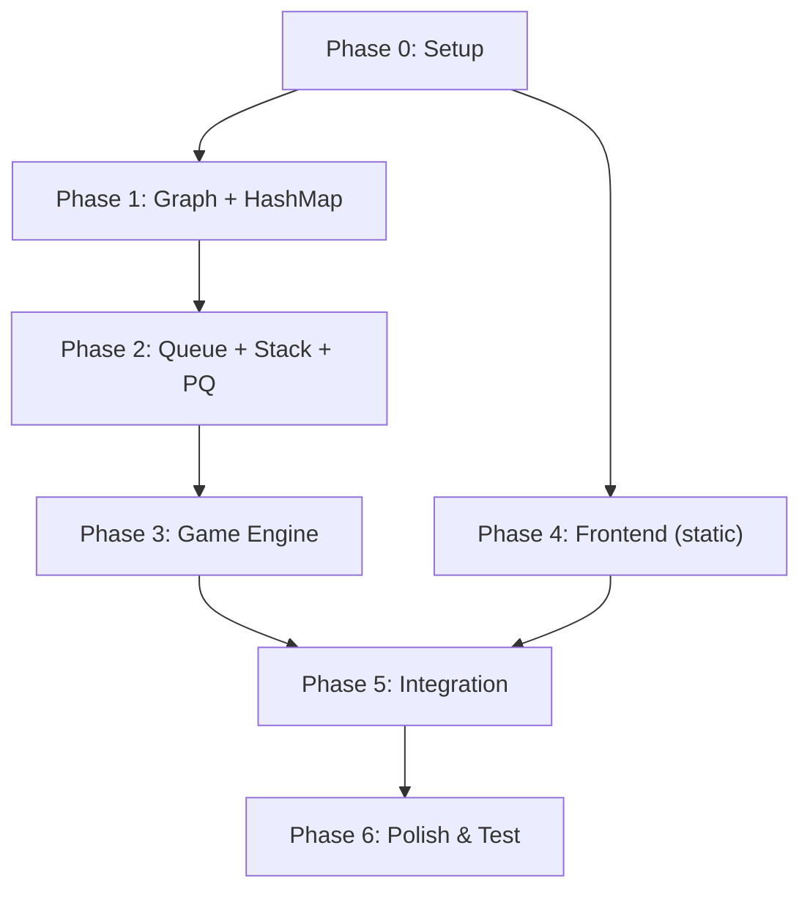

# 🔓 EscapeX — Development Phases

> Step-by-step build plan. Each phase is self-contained and testable.
> Do NOT skip phases. Complete and verify each one before moving to the next.

---

## Phase Overview

```
Phase 0 ──► Phase 1 ──► Phase 2 ──► Phase 3 ──► Phase 4 ──► Phase 5 ──► Phase 6
 Setup      Graph &     Queue &      Game        Frontend    Connect     Polish
            HashMap     Stack &PQ    Engine      HTML/CSS    Frontend    & Test
                                                             to Backend
```

| Phase | Name | What You Build | Deliverable |
|---|---|---|---|
| 0 | Project Setup | Folder structure, download httplib.h, verify compiler | Compiles and runs "Hello World" server |
| 1 | Data Structures: Graph + HashMap | Adjacency list for rooms, HashMap for room data | Print room connections and room details |
| 2 | Data Structures: Queue + Stack + PQ | Question queue, completion stack, difficulty PQ | Demonstrate enqueue/dequeue, push/pop, priority extraction |
| 3 | Game Engine | All game logic — start, answer, timer, scoring | Fully working game via curl/API testing |
| 4 | Frontend | HTML structure, CSS styling, room map visual | Static UI that looks like the final game |
| 5 | Integration | Connect frontend to backend with fetch() | Playable game in the browser |
| 6 | Polish & Test | Edge cases, final testing, documentation | Finished, polished, submitted project |

---

## Phase 0: Project Setup

**Goal:** Get the project skeleton ready. Verify everything compiles.

### Tasks

- [ ] Create the project folder structure:
  ```
  ADS (Project)/
  ├── backend/
  │   ├── game_server.cpp
  │   ├── httplib.h
  │   └── questions.h
  ├── frontend/
  │   ├── index.html
  │   ├── style.css
  │   └── game.js
  ├── EscapeX_Project.md
  ├── phases.md
  └── README.md
  ```

- [ ] Download `httplib.h` from GitHub (single file)
  ```bash
  # In the backend/ folder:
  curl -O https://raw.githubusercontent.com/yhirose/cpp-httplib/master/httplib.h
  ```

- [ ] Create a minimal `game_server.cpp` that starts the HTTP server:
  ```cpp
  #include "httplib.h"
  #include <iostream>
  using namespace std;

  int main() {
      httplib::Server server;

      server.Get("/", [](const httplib::Request&, httplib::Response& res) {
          res.set_content("EscapeX Server is running!", "text/plain");
      });

      cout << "Server running at http://localhost:8080" << endl;
      server.listen("localhost", 8080);
      return 0;
  }
  ```

- [ ] Compile and test:
  ```bash
  g++ -std=c++17 -o game_server game_server.cpp -lpthread
  ./game_server
  # Visit http://localhost:8080 → should show "EscapeX Server is running!"
  ```

### Verification
- ✅ Server starts without errors
- ✅ Browser shows the text response
- ✅ `Ctrl+C` stops the server cleanly

### Estimated Time: 30 minutes

---

## Phase 1: Data Structures — Graph + HashMap

**Goal:** Implement the room graph (adjacency list) and room data storage (hash map).

### Tasks

- [ ] Define the `Room` struct:
  ```cpp
  struct Room {
      int id;
      string name;
      int difficulty;       // 1=easy, 2=medium, 3=hard
      bool isLocked;
      bool isCompleted;
      int questionId;       // -1 if not assigned yet
      int score;            // 0 if not completed
  };
  ```

- [ ] Create the Graph (adjacency list):
  ```cpp
  // GRAPH — adjacency list for 9 rooms
  vector<vector<int>> adjacencyList(10); // index 0 unused, rooms 1-9

  void initializeGraph() {
      adjacencyList[1] = {2, 4};
      adjacencyList[2] = {1, 3, 5};
      adjacencyList[3] = {2, 6};
      adjacencyList[4] = {1, 5, 7};
      adjacencyList[5] = {2, 4, 6, 8};
      adjacencyList[6] = {3, 5, 9};
      adjacencyList[7] = {4, 8};
      adjacencyList[8] = {5, 7, 9};
      adjacencyList[9] = {6, 8};
  }
  ```

- [ ] Create the HashMap (room data):
  ```cpp
  // HASHMAP — room data keyed by room ID
  unordered_map<int, Room> roomMap;

  void initializeRooms() {
      roomMap[1] = {1, "The Lobby",    1, false, false, -1, 0};
      roomMap[2] = {2, "The Library",  1, true,  false, -1, 0};
      roomMap[3] = {3, "The Lab",      2, true,  false, -1, 0};
      roomMap[4] = {4, "The Workshop", 1, true,  false, -1, 0};
      roomMap[5] = {5, "The Hall",     2, true,  false, -1, 0};
      roomMap[6] = {6, "The Vault",    3, true,  false, -1, 0};
      roomMap[7] = {7, "The Dungeon",  2, true,  false, -1, 0};
      roomMap[8] = {8, "The Tower",    3, true,  false, -1, 0};
      roomMap[9] = {9, "The Escape",   3, true,  false, -1, 0};
  }
  ```

- [ ] Write a helper function to get neighbors:
  ```cpp
  vector<int> getNeighbors(int roomId) {
      return adjacencyList[roomId];
  }
  ```

- [ ] Write a function to unlock neighboring rooms:
  ```cpp
  void unlockNeighbors(int roomId) {
      for (int neighborId : adjacencyList[roomId]) {
          roomMap[neighborId].isLocked = false;
      }
  }
  ```

- [ ] Add a test API endpoint:
  ```cpp
  server.Get("/api/rooms", [](const auto& req, auto& res) {
      string json = "[";
      for (int i = 1; i <= 9; i++) {
          Room& room = roomMap[i];
          json += "{\"id\":" + to_string(room.id) + ",";
          json += "\"name\":\"" + room.name + "\",";
          json += "\"difficulty\":" + to_string(room.difficulty) + ",";
          json += "\"isLocked\":" + string(room.isLocked ? "true" : "false") + ",";
          json += "\"neighbors\":[";
          for (int j = 0; j < adjacencyList[i].size(); j++) {
              json += to_string(adjacencyList[i][j]);
              if (j < adjacencyList[i].size() - 1) json += ",";
          }
          json += "]}";
          if (i < 9) json += ",";
      }
      json += "]";
      res.set_content(json, "application/json");
  });
  ```

### Verification
- ✅ `curl http://localhost:8080/api/rooms` returns JSON with all 9 rooms
- ✅ Each room has correct name, difficulty, and neighbor list
- ✅ Room 1 is unlocked, rooms 2-9 are locked
- ✅ Calling `unlockNeighbors(1)` makes rooms 2 and 4 unlocked

### Estimated Time: 1-2 hours

---

## Phase 2: Data Structures — Queue + Stack + Priority Queue

**Goal:** Implement question management (queue), completion tracking (stack), and dynamic difficulty (priority queue).

### Tasks

- [ ] Define the `Question` struct:
  ```cpp
  struct Question {
      int id;
      string text;
      string hint;
      vector<string> options;  // 4 choices
      int correctOption;       // 0, 1, 2, or 3
      int difficulty;          // 1, 2, or 3
      int points;              // 10, 20, or 30

      // Comparison for priority queue (higher difficulty = higher priority)
      bool operator<(const Question& other) const {
          return difficulty < other.difficulty;
      }
  };
  ```

- [ ] Create the question bank in `questions.h`:
  ```cpp
  // 10 easy + 10 medium + 10 hard = 30 questions total
  // Topics: Logic puzzles, Math patterns, General Knowledge, Basic DSA
  // NO trivially easy questions like "2+2"
  // Each question: {id, text, hint, {opt1,opt2,opt3,opt4}, correct, difficulty, points}
  ```

- [ ] Implement the Queue — question loading and shuffling:
  ```cpp
  queue<Question> questionQueue;

  void loadQuestions() {
      // 1. Copy all questions into a vector
      vector<Question> allQuestions;
      // ... fill from questions.h

      // 2. Shuffle randomly
      srand(time(NULL));
      for (int i = allQuestions.size() - 1; i > 0; i--) {
          int j = rand() % (i + 1);
          swap(allQuestions[i], allQuestions[j]);
      }

      // 3. Push into the queue
      for (int i = 0; i < allQuestions.size(); i++) {
          questionQueue.push(allQuestions[i]);
      }
  }
  ```

- [ ] Implement the Priority Queue — difficulty management:
  ```cpp
  priority_queue<Question> difficultyPQ;

  void loadDifficultyQueue() {
      // Load medium and hard questions into the PQ
      // Easy questions stay in the regular queue
      // The PQ will automatically sort by difficulty (hard first)
  }
  ```

- [ ] Implement question assignment to rooms:
  ```cpp
  void assignQuestionsToRooms() {
      for (int i = 1; i <= 9; i++) {
          Room& room = roomMap[i];

          if (room.difficulty == 1) {
              // Easy room: take from regular queue
              Question q = questionQueue.front();
              questionQueue.pop();
              room.questionId = q.id;
          } else {
              // Medium/Hard room: take from priority queue
              Question q = difficultyPQ.top();
              difficultyPQ.pop();
              room.questionId = q.id;
          }
      }
  }
  ```

- [ ] Implement the Stack — completion tracking:
  ```cpp
  stack<int> completedStack;

  void pushCompleted(int roomId) {
      completedStack.push(roomId);
  }

  string getCompletionHistory() {
      // Pop all items and build a JSON array
      // This shows rooms in reverse order (most recent first)
      string json = "[";
      stack<int> tempStack = completedStack; // copy to preserve
      bool first = true;
      while (!tempStack.empty()) {
          int roomId = tempStack.top();
          tempStack.pop();
          if (!first) json += ",";
          json += "{\"roomId\":" + to_string(roomId);
          json += ",\"name\":\"" + roomMap[roomId].name + "\"";
          json += ",\"score\":" + to_string(roomMap[roomId].score) + "}";
          first = false;
      }
      json += "]";
      return json;
  }
  ```

- [ ] Add test API endpoints for each:
  ```
  GET /api/test/queue     → shows front of question queue
  GET /api/test/stack     → shows completion history
  GET /api/test/pq        → shows top of priority queue
  ```

### Verification
- ✅ Queue: Questions come out in shuffled order, no duplicates
- ✅ Stack: Push 3 rooms, pop shows them in reverse order
- ✅ PQ: Hardest questions come out first
- ✅ Room assignment: Easy rooms get easy questions, hard rooms get hard questions

### Estimated Time: 2-3 hours

---

## Phase 3: Game Engine

**Goal:** Wire all data structures together into a working game with timer, scoring, and all mechanics.

### Tasks

- [ ] Implement `startGame()`:
  ```cpp
  void startGame(int chosenTime) {
      // 1. Reset all state
      // 2. Set timer to player's chosen duration (60-300 seconds)
      totalTime = chosenTime;
      timePenalty = 0;
      // 3. Initialize graph
      // 4. Initialize rooms (all locked except Room 1)
      // 5. Shuffle and load questions into queue and PQ
      // 6. Assign questions to rooms
      // 7. Start the timer
      gameStartTime = time(NULL);
      gameActive = true;
      totalScore = 0;
      // Clear the stack
      while (!completedStack.empty()) completedStack.pop();
  }
  ```

- [ ] Implement `getTimeRemaining()`:
  ```cpp
  int getTimeRemaining() {
      if (!gameActive) return 0;
      int elapsed = (int)(time(NULL) - gameStartTime);
      int remaining = totalTime - elapsed - timePenalty;
      if (remaining <= 0) {
          gameActive = false;
          return 0;
      }
      return remaining;
  }
  ```

- [ ] Implement `submitAnswer(int roomId, int answer)`:
  ```cpp
  string submitAnswer(int roomId, int answer) {
      Room& room = roomMap[roomId];
      Question& question = getQuestionById(room.questionId);

      if (answer == question.correctOption) {
          // CORRECT
          room.isCompleted = true;
          room.score = question.points;
          totalScore += room.score;
          completedStack.push(roomId);     // STACK: push
          unlockNeighbors(roomId);         // GRAPH: check adjacency
          return buildCorrectJSON(room);
      } else {
          // WRONG
          timePenalty += 5;                // 5-second time penalty
          return buildWrongJSON();
      }
  }
  ```

- [ ] Implement `getGameState()`:
  ```cpp
  string getGameState() {
      // Returns JSON with:
      // - timeRemaining
      // - totalScore
      // - gameActive
      // - all rooms with their current status
      // - number of completed rooms
  }
  ```

- [ ] Implement hint system:
  ```cpp
  string getHint(int roomId) {
      Room& room = roomMap[roomId];
      Question& q = getQuestionById(room.questionId);
      room.score = max(0, q.points - 5);  // Reduce reward
      return "{\"hint\":\"" + q.hint + "\"}";
  }
  ```

- [ ] Set up all API endpoints:
  ```
  GET  /api/start?time=300  → startGame(chosenTime)  // time=60,120,180,240,300
  GET  /api/state          → getGameState()
  GET  /api/room/:id       → getRoomDetails(id)
  POST /api/answer         → submitAnswer(roomId, answer)
  GET  /api/hint/:roomId   → getHint(roomId)
  GET  /api/history        → getCompletionHistory()
  ```

- [ ] Implement game-over detection:
  ```cpp
  // In getTimeRemaining() or getGameState():
  if (remaining <= 0) {
      gameActive = false;
      // Game is over — client will detect this and show results
  }
  ```

### Verification (all via curl)
- ✅ `curl /api/start` → game starts, Room 1 unlocked
- ✅ `curl /api/room/1` → shows question with 4 options
- ✅ `curl -X POST /api/answer -d '{"roomId":1,"answer":1}'` → correct response
- ✅ After correct answer: score increases, neighbors unlocked, stack updated
- ✅ After wrong answer: time decreases by 5 seconds, can retry unlimited times
- ✅ `curl /api/hint/1` → returns hint, score reduced
- ✅ `curl /api/state` → time is counting down
- ✅ When time reaches 0: `gameActive` is false
- ✅ `curl /api/history` → shows rooms in reverse completion order

### Estimated Time: 3-4 hours

---

## Phase 4: Frontend (Static UI)

**Goal:** Build the complete game interface in HTML/CSS. No backend connection yet — use dummy data.

### Tasks

- [ ] Build `index.html` with three screens:
  1. **Start Screen** — game title, description, **timer duration dropdown (1-5 min)**, Start button
  2. **Game Screen** — timer, score, room map, puzzle area
  3. **Result Screen** — final score, completion history, Play Again button

- [ ] Design the room map as a 3×3 CSS grid:
  ```html
  <div id="room-map">
      <div class="room locked" id="room-1">1<br>The Lobby</div>
      <div class="room locked" id="room-2">2<br>The Library</div>
      <!-- ... 9 rooms total -->
  </div>
  ```

- [ ] Style rooms with CSS:
  ```css
  .room { /* base card style */ }
  .room.locked { background: #ccc; cursor: not-allowed; }
  .room.unlocked { background: #4a9eff; cursor: pointer; }
  .room.completed { background: #4caf50; }
  .room.current { border: 3px solid #ff9800; }
  ```

- [ ] Build the puzzle display area:
  ```html
  <div id="puzzle-area">
      <h3 id="question-text">What is 2 + 2?</h3>
      <div id="options">
          <button class="option" onclick="submitAnswer(0)">3</button>
          <button class="option" onclick="submitAnswer(1)">4</button>
          <button class="option" onclick="submitAnswer(2)">5</button>
          <button class="option" onclick="submitAnswer(3)">6</button>
      </div>
      <button id="hint-btn" onclick="showHint()">💡 Show Hint (-5 pts)</button>
      <p id="hint-text" hidden></p>
  </div>
  ```

- [ ] Build the header bar:
  ```html
  <div id="header">
      <span id="timer">⏱ 5:00</span>
      <span id="game-title">🔓 EscapeX</span>
      <span id="score">🏆 Score: 0</span>
  </div>
  ```

- [ ] Build the results screen:
  ```html
  <div id="result-screen">
      <h2>🎉 Game Over!</h2>
      <p>Final Score: <span id="final-score">0</span></p>
      <h3>Completion History</h3>
      <ol id="history-list">
          <!-- filled dynamically -->
      </ol>
      <button onclick="location.reload()">🔄 Play Again</button>
  </div>
  ```

- [ ] Apply CSS styling:
  - Clean, modern look with rounded corners and shadows
  - Color scheme: blues, greens, grays
  - Responsive basic layout (centered, max-width)
  - Smooth transitions for room state changes
  - Timer turns red when < 30 seconds

### Verification
- ✅ Open `index.html` directly in browser (no server needed for this phase)
- ✅ Start screen shows correctly with title and button
- ✅ Room map displays 9 rooms in a grid
- ✅ Rooms show correct colors for locked/unlocked/completed states
- ✅ Puzzle area displays question with 4 clickable options
- ✅ Results screen shows score and history list

### Estimated Time: 2-3 hours

---

## Phase 5: Integration (Connect Frontend to Backend)

**Goal:** Wire the frontend to the C++ backend using `fetch()` calls.

### Tasks

- [ ] Implement `startGame()` in JS:
  ```javascript
  async function startGame() {
      let timerValue = document.getElementById("timer-select").value;
      let response = await fetch("/api/start?time=" + timerValue);
      let data = await response.json();
      // Hide start screen, show game screen
      // Update room map with initial state
      // Start the timer display loop
  }
  ```

- [ ] Implement timer polling (every 1 second):
  ```javascript
  let timerInterval;

  function startTimer() {
      timerInterval = setInterval(async () => {
          let response = await fetch("/api/state");
          let data = await response.json();
          updateTimer(data.timeRemaining);
          if (!data.gameActive) {
              clearInterval(timerInterval);
              showResults();
          }
      }, 1000);
  }
  ```

- [ ] Implement room click handler:
  ```javascript
  async function enterRoom(roomId) {
      let response = await fetch("/api/room/" + roomId);
      let data = await response.json();
      // Display the question and options in the puzzle area
  }
  ```

- [ ] Implement answer submission:
  ```javascript
  async function submitAnswer(optionIndex) {
      let response = await fetch("/api/answer", {
          method: "POST",
          headers: {"Content-Type": "application/json"},
          body: JSON.stringify({roomId: currentRoomId, answer: optionIndex})
      });
      let data = await response.json();
      if (data.correct) {
          // Show success feedback
          // Update room map (mark completed, unlock neighbors)
          // Update score display
      } else {
          // Show error feedback
          // Update timer display
      }
  }
  ```

- [ ] Implement hint fetching:
  ```javascript
  async function showHint() {
      let response = await fetch("/api/hint/" + currentRoomId);
      let data = await response.json();
      document.getElementById("hint-text").innerText = data.hint;
      document.getElementById("hint-text").hidden = false;
  }
  ```

- [ ] Implement results display:
  ```javascript
  async function showResults() {
      let response = await fetch("/api/history");
      let data = await response.json();
      // Build the history list from the stack data
      // Show final score
      // Switch to result screen
  }
  ```

- [ ] Configure the C++ server to serve frontend files:
  ```cpp
  // In main():
  server.set_mount_point("/", "../frontend");
  ```

### Verification
- ✅ Start the C++ server, open `http://localhost:8080` in browser
- ✅ Click "Start Game" → timer starts, Room 1 is clickable
- ✅ Click Room 1 → question appears
- ✅ Click correct answer → room turns green, score updates, neighbors unlock
- ✅ Click wrong answer → timer drops, can retry
- ✅ Click hint → hint text appears
- ✅ Timer reaches 0 → results screen appears automatically
- ✅ Click "Play Again" → game resets completely

### Estimated Time: 2-3 hours

---

## Phase 6: Polish & Final Testing

**Goal:** Fix edge cases, add visual polish, test thoroughly, finalize documentation.

### Tasks

- [ ] Edge case handling:
  - Clicking a locked room → show "Room is locked" message
  - Clicking a completed room → show "Already completed" message
  - Submitting answer after game over → reject
  - Starting a new game while one is running → reset properly
  - Empty question queue → should never happen (30 questions > 9 rooms)

- [ ] Visual polish:
  - Add CSS transition animations for room state changes
  - Flash green/red on correct/wrong answers
  - Timer blinks red when < 30 seconds
  - Add room difficulty labels (⭐, ⭐⭐, ⭐⭐⭐) on the map
  - Add a simple "connecting lines" effect between rooms (CSS borders or SVG)

- [ ] Add feedback messages:
  - "🎉 Correct! +10 points! Rooms 2 and 4 unlocked!"
  - "❌ Wrong! -15 seconds. Try again!"
  - "💡 Hint revealed: ..."
  - "⏱ Time's up! Final score: 80"

- [ ] Add CORS headers (if needed):
  ```cpp
  server.set_default_headers({
      {"Access-Control-Allow-Origin", "*"}
  });
  ```

- [ ] Full playthrough testing:
  - Play the complete game start to finish at least 3 times
  - Test: completing all rooms before time runs out
  - Test: running out of time mid-game
  - Test: using hints on every room
  - Test: getting every answer wrong (time penalty stress test)
  - Test: playing again after game over

- [ ] Finalize `README.md` with setup instructions and screenshots

- [ ] Review all code against the Strict Coding Rulebook

### Verification
- ✅ All edge cases handled gracefully (no crashes, no broken UI)
- ✅ Visual feedback is clear and immediate
- ✅ Game is playable from start to finish without issues
- ✅ Play Again works perfectly
- ✅ Code follows all rules in the Coding Rulebook
- ✅ Documentation is complete

### Estimated Time: 2-3 hours

---

## Total Estimated Time

| Phase | Time |
|---|---|
| Phase 0: Setup | 30 min |
| Phase 1: Graph + HashMap | 1-2 hours |
| Phase 2: Queue + Stack + PQ | 2-3 hours |
| Phase 3: Game Engine | 3-4 hours |
| Phase 4: Frontend | 2-3 hours |
| Phase 5: Integration | 2-3 hours |
| Phase 6: Polish | 2-3 hours |
| **Total** | **~13-19 hours** |

---

## Build Order Dependency



> **Note:** Phase 4 (Frontend) can be built **in parallel** with Phases 1-3 (Backend). The frontend uses dummy data until Phase 5 connects everything.

---

*Each phase is designed to be completable in a single sitting.*
*Do not move to the next phase until the current one passes all verification checks.*
